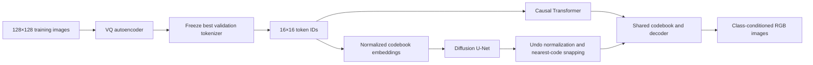

# Animal Face Generation: Latent Diffusion vs Autoregressive Transformers

[GitHub repository](https://github.com/gour6380/Animal-Face-Generation) · [Technical report](reports/technical-report.md) · [Run notebook](notebooks/animal_face_generation_public.ipynb)

Generate 128×128 cat, dog and wildlife faces with two compact, class-conditioned PyTorch systems trained from scratch. A DDPM-trained U-Net and an autoregressive Transformer share one frozen VQ autoencoder. The notebook is the execution interface; ordinary local modules contain the implementation. No custom package installation or experiment CLI is needed.

**Recorded result:** `run_001` completed **100 tokenizer epochs and 200 epochs for each generator** on two NVIDIA L40S GPUs. All six sampling settings, metrics and benchmarks completed. The Transformer produced recognizable, imperfect animal faces; diffusion produced abstract patterns. This is a completed experiment with an unresolved diffusion failure, not evidence that either model family is universally better.

Read the [technical report](reports/technical-report.md) for the results, training curves, visual evidence, protocol deviations and limitations. The [compact evidence directory](reports/run_001/) preserves selected records for review. Full checkpoints, datasets and jobs are local artifacts excluded from Git.

## Install and run

For a published checkout:

```sh
git clone https://github.com/gour6380/Animal-Face-Generation.git
cd Animal-Face-Generation
```

The SSH clone URL is `git@github.com:gour6380/Animal-Face-Generation.git`. On RunPod, use the existing Python 3 kernel and the installation cell below. On a Mac without an existing project environment, create a native Python 3.13 environment and start Jupyter:

```sh
python3.13 -m venv .venv
source .venv/bin/activate
python -m pip install -r requirements-dev.txt
python -m jupyter lab notebooks/animal_face_generation_public.ipynb
```

The public notebook has no saved outputs. Its code retains the recorded **100 / 200 / 200 epochs** and **zero generator warm-up** for traceability. Select a one-epoch smoke test in the three configuration cells before a new host's first run. Full evaluation remains enabled even for a smoke run.

1. Place the project folder on persistent storage. Open [the public notebook](notebooks/animal_face_generation_public.ipynb) with RunPod's existing **Python 3** kernel. Python 3.13 is preferred; the recorded cloud run used **Python 3.12.3**. Reuse an existing local environment on macOS. A new environment or kernel registration is not required for the supplied RunPod workflow.
2. Run the project-root cell. It moves from `notebooks/` to its parent if needed and sets `PROJECT_ROOT = Path(".")`. Start from the project root or its `notebooks/` directory. There are no personal paths or `sys.path` changes.
3. Run the installation cell before importing project modules. It uses the current kernel's Python. Alternatively, from a terminal at the project root, using that same interpreter:

   ```sh
   python -m pip install -r requirements.txt
   ```

   If installation replaces packages already imported by the kernel, restart it and continue from the top while skipping installation. Do not start simultaneous pip installations. Runtime requirements reuse compatible shared dependencies, including Debian-managed `pyparsing>=3`, and do not replace the Jupyter server or kernel. Optional authoring/test tools live in `requirements-dev.txt`.
4. Execute hardware inspection. For two GPUs, check for `cuda_multiple`, two distinct UUIDs and tokenizer world size 2. The supplied Linux PyTorch build uses CUDA 13 and requires a compatible driver. The recorded run used **PyTorch 2.14.0+cu130**, torchvision 0.29.0 and driver **595.91.07**. Inspection checks the CUDA build before training.
5. Review each configuration cell **before creating a run**. The public notebook contains **100 / 200 / 200 epochs, with zero generator warm-up**. Its markdown distinguishes that recorded configuration from a smoke run and the intended future schedule. Choose an epoch budget below.
6. Leave `RUN_NAME = None` for a fresh run. Execute the create/open cell once; repeating it in fresh mode deliberately creates another numbered run. Resume requires an explicit existing name and its original configuration, source, environment and topology.
7. Execute preparation in order: download → inventory → split preparation → training-image inspection → frozen-weight acquisition. These explicit acquisition cells cache assets once per project storage location and reuse them across runs.
8. Inspect and train the tokenizer, evaluate reconstructions, freeze its selected checkpoint, then cache training and validation tokens. Both generators must use the same frozen tokenizer and token cache.
9. Run the separate diffusion and Transformer launch cells, inspect worker status, then execute the **wait cell before evaluation**. Two CUDA GPUs train the generators concurrently; single-device systems queue them sequentially.
10. Freeze evaluation settings/checkpoints, prepare the held-out reference, and execute each sampling, metric, benchmark and figure cell. Benchmarks run serially after training. Finish with the report and optional saved-model inference/TensorBoard cells.

**Run All installs dependencies, downloads missing assets and starts training and full evaluation.** Opening the notebook or importing/inspecting modules alone does not do this. The original executed notebook is preserved locally and excluded from Git; it contains prior outputs, including AFHQ examples and reconstructions. The public copy has the same code-cell sources with cleared outputs and corrected explanatory text. Respect [NOTICE.md](NOTICE.md) and the dataset's noncommercial terms when sharing results.

| Purpose | Tokenizer epochs | Diffusion epochs | Transformer epochs | Generator warm-up |
|---|---:|---:|---:|---:|
| Pipeline smoke test | 1 | 1 | 1 | 0 |
| Recorded `run_001` | 100 | 200 | 200 | **0** |
| Original full-budget protocol, for a future fresh run | 100 | 200 | 200 | **5** |

A one-epoch run tests the pipeline, not converged quality. The current scheduler treats `warmup_epochs=0` as **constant learning rate for the whole run**; `minimum_lr_fraction=0.1` has no effect in that branch. Five warm-up epochs enable the intended warm-up followed by cosine decay to 10% of the initial rate. Tokenizer learning rate stays constant.

Do not extend the completed run or replace its configuration. Changing epochs, batches or schedules requires a fresh run. More training is not currently justified: Transformer validation loss worsened after epoch 21, and diffusion needs diagnosis using existing checkpoints before another training budget is chosen. Any follow-up informed by these held-out results must be labelled exploratory.

Requirements pin the scientific runtime but are not a complete transitive hash lock. Every run records all installed versions and snapshots its requirements. Keep matching source and environment records with checkpoints. The [dependency verification record](verification/pip-resolution.json) describes preparation checks and their limits. No editable package, experiment CLI, environment-path guard or custom kernel name is required.

## Experiment

With the same data, frozen image representation and generator training exposure, how do these specific systems compare in quality, diversity and latency? Equal exposure does not control parameter count, compute or convergence. The compact architectures and nonadversarial tokenizer are adaptations of the cited research, not reproductions. There is one seed and no automatic hyperparameter search or early stopping.



## How the recorded run executed

The downloaded notebook and **35 successful job receipts** document the run on **1 October 2026**. It used two NVIDIA L40S GPUs, Python 3.12.3 and FP32 eager execution with AMP and TF32 disabled. UUID assignments put one tokenizer DDP rank on each GPU, then one generator worker on each GPU.

| Stage | Epochs | Microbatch | Global effective batch | Worker duration |
|---|---:|---:|---:|---:|
| Tokenizer, two DDP ranks | 100 | 8 per GPU | 64 | 44.86 min |
| Diffusion, one GPU | 200 | 32 | 64 | 46.07 min |
| Transformer, other GPU | 200 | 32 | 64 | 44.18 min |

Generator durations overlap; do not add them as sequential wall time. Saved epoch training-plus-validation totals were 43.81, 43.08 and 41.84 minutes respectively; worker durations additionally include setup and checkpoint overhead. Token caching took approximately 13 seconds. The sequence from hardware inspection to report completion spanned approximately **1 hour 43 minutes**, including notebook gaps and using cached assets. This excludes earlier installation, initial downloads and startup troubleshooting. These durations come from the [worker receipts](reports/run_001/jobs.csv).

The tokenizer saw **1,290,400 training-image exposures** and each generator saw **2,580,800**. Parameter counts were 7,467,843 for the tokenizer, 10,940,288 for diffusion and 11,140,224 for the Transformer. Both generators retained zero warm-up, so all 200 epochs used constant learning rates rather than the planned cosine schedule.

The balanced held-out reference and each generated setting contain **483 images per class**, or **1,449 images** in total. Primary results use final diffusion EMA with DDIM-50 and final Transformer weights at temperature 1.0:

| Primary result | Diffusion DDIM-50 | Transformer temperature 1.0 |
|---|---:|---:|
| Macro per-class KID ↓ | 0.336511 | 0.022591 |
| Overall KID ↓ | 0.300323 | 0.014726 |
| Overall feature precision ↑ | 0.0000 | 0.5328 |
| Overall feature recall ↑ | 0.0000 | 0.4023 |
| Warm batch-1 median latency ↓ | 0.2824 s | 0.4572 s |
| Warm batch-8 throughput ↑ | 27.214 images/s | 16.242 images/s |

Diffusion was faster at these settings but failed to produce recognizable faces, including in the illustrative DDPM grid. Its speed therefore does not establish a useful quality/speed trade-off. Static review found no definitive sampler or normalization fault; the failure cause remains unresolved. The Transformer produced recognizable, imperfect faces and overfit: validation cross-entropy was best at epoch 21 (about 3.43), compared with about 4.49 at epoch 200. The final checkpoint remains the predeclared primary result; a different checkpoint is a separate diagnostic analysis.

The selected tokenizer produced recognizable but blurred reconstructions: validation PSNR **23.12 dB**, LPIPS **0.262**, and **62 of 512 codes used** (12.11%; perplexity 57.53). This shared representation limitation does not by itself explain the difference between generators. The report covers all six settings and the remaining validity and portability limitations.

## Device execution and local environment

Automatic selection is **MPS → multiple CUDA GPUs → single CUDA GPU → CPU**. Only the first two visible CUDA devices are selected; their UUIDs, models, capabilities and memory are recorded. Additional GPUs remain unused. Device memory is separate per GPU, not pooled.

| Hardware | Tokenizer | Diffusion and Transformer |
|---|---|---|
| MPS | One worker | Sequential isolated workers |
| Two or more CUDA GPUs | Two DDP ranks, one GPU each | Concurrent isolated workers, one GPU per model |
| One CUDA GPU | One worker | Sequential isolated workers |
| CPU | One worker | Sequential isolated workers |

Tokenizer [DistributedDataParallel](https://docs.pytorch.org/tutorials/intermediate/ddp_tutorial.html) uses NCCL on CUDA. Each deterministic global batch is sharded without dropping or duplicating examples; accumulated gradients are weighted by actual sample counts. Rank zero validates and commits checkpoints, metrics and TensorBoard events. Frozen LPIPS remains in evaluation mode while gradients reach reconstructed images.

The recorded run establishes memory fit for its settings on that L40S host, not a measured multi-GPU speedup. Generation, evaluation and benchmarks run serially after training; benchmarks use the first selected device. Unsupported operations, nonfinite loss or OOM fail without silently changing batches or precision.

## L40S notebook settings

These are the explicit batch settings used in the completed L40S run. Architectures, initial learning rates, seeds, losses, global effective batch and FP32 remained as planned. The zero-warm-up schedule deviation is documented above.

| Control | L40S notebook | Conservative local-module default |
|---|---:|---:|
| Tokenizer training microbatch, per GPU | 8 | 4 |
| Diffusion / Transformer training microbatch | 32 / 32 | 16 / 16 |
| Global effective training batch | 64 | 64 |
| Reconstruction / token-cache inference batch | 64 | 32 |
| Generation batch | 16 | 8 |
| Inception feature extraction batch | 32 | 8 |
| CPU threads per worker / inventory threads | 4 / 8 | 4 / 8 |
| DataLoader workers | 0 | 0 |

`src/config.py` retains the conservative local-module defaults for the M2 Pro workflow; the notebook explicitly overrides the batch values for L40S in its separate configuration cells. Device selection never silently changes these values. Before using this notebook on MPS or CPU, restore the conservative batch values in those cells and create a fresh run. Their memory fit still needs execution on the selected hardware.

Bulk generation batch 16 is independent of benchmark batches 1 and 8. Batch changes can alter rounding and random-draw grouping, so a fresh configuration is not promised bitwise equivalence. A one-epoch smoke test can verify a new host; it does not replace failure analysis of this completed run.

## L40S startup and observability

An earlier NCCL startup stalled without epoch progress despite both GPUs reporting 100% utilization. The successful retry and recorded notebook set this before tokenizer workers launch:

```python
os.environ.update(NCCL_DEBUG="INFO", NCCL_P2P_DISABLE="1")
```

This **Pod-specific transport workaround** keeps both GPUs and NCCL but disables direct P2P transport; the successful retry log used shared-memory transport. It is not a universal performance default. The GPUs crossed NUMA nodes (`SYS`); reported P2P capability `OK` did not establish working transfers. Current source binds each UUID-isolated rank to its local `cuda:0`. On another host, choose transport settings explicitly before a fresh run.

For a stall, interrupt the action, then use `launcher.cancel_all()` once the kernel is idle to cancel remaining tracked workers. Inspect `nvidia-smi` to confirm process exit. Read-only diagnostics are `nvidia-smi topo -m`, `nvidia-smi topo -p2p p` and `df -h /dev/shm`. See [NVIDIA's communication troubleshooting guide](https://docs.nvidia.com/deeplearning/nccl/user-guide/docs/troubleshooting/gpu_troubleshooting.html).

`launcher.status()` shows jobs and elapsed time without ten-minute alerts. `jobs/` holds worker logs, results and five-second CPU/RAM/CUDA samples. Host-visible RAM/CPU counts can exceed the Pod allocation; process-tree RSS can count shared pages twice; GPU utilization can include communication waits. Prefer throughput and stage duration over a 100% utilization target.

Preparation uses a shared packed RGB128 snapshot, eight bounded I/O threads and per-row integrity verification instead of repeated raw-image decoding/scanning. Inference uses larger independent batches, preallocated Transformer KV caches and bounded PNG writers. These are implementation choices, not a claim of cross-device numerical parity.

## Data and pretrained supervision

The authors' [AFHQ v2 release](https://github.com/clovaai/stargan-v2#animal-faces-hq-dataset-afhq) contains 15,803 images and is distributed under **CC BY-NC 4.0** for noncommercial use. Preserve attribution and applicable restrictions; see [NOTICE.md](NOTICE.md) and the [upstream license](https://github.com/clovaai/stargan-v2/blob/master/LICENSE).

- Upstream training images receive a stratified 10% development-validation split, seed 1001, rounding validation counts down per class. The recorded split has **12,904 training and 1,432 validation images**.
- Upstream `test` in this v2 archive (`val` in a supported legacy layout) stays held out for final evaluation. It is excluded from early exploration and checkpoint selection. Folder `wild` has display label **wildlife**.
- Deterministic RGB conversion, Lanczos resize to 128×128 and normalization to `[-1, 1]`; no augmentation. Corrupt files and exact cross-split byte/pixel duplicates fail explicitly.
- Inventory records actual counts, file hashes and a shared packed RGB128 snapshot. Runs link to immutable project caches rather than duplicate raw images. Subsequent stages verify the manifest chain and consumed rows.
- Before training, the balanced evaluation count is `min(500, smallest verified held-out class count)`, which was **483** here. Sampling settings and checkpoint hashes are frozen before final evaluation.

Frozen [LPIPS-VGG v0.1](https://github.com/richzhang/PerceptualSimilarity) uses ImageNet VGG-16 features and learned calibration weights for reconstruction supervision. Evaluation uses [torch-fidelity](https://github.com/toshas/torch-fidelity)'s frozen `inception-v3-compat` 2,048-dimensional features. Acquisition is explicit and later loaders verify recorded hashes without implicit downloads. The three trainable models initialize from scratch, but the reconstruction objective includes pretrained visual supervision.

## Models and optimization

| Component | Configuration |
|---|---|
| VQ autoencoder | Three downsampling stages, 64/128/256 channels, two residual blocks per stage; GroupNorm/SiLU; 512 entries × 64 dimensions; 16×16 grid; symmetric nearest-neighbor upsampling/convolutions and tanh output |
| Tokenizer loss | L1 + 0.1 LPIPS + codebook loss + 0.25 commitment loss; separate gradient ownership and straight-through path; no discriminator |
| Diffusion prior | Latent 64×16×16; U-Net levels 16→8→4, channels 64→128→256, two residual blocks, four-head attention at 8 and 4; time plus class conditioning |
| Noise schedule | 1,000 linear beta steps from 0.0001 to 0.02; Gaussian-noise prediction; EMA decay 0.999 |
| Transformer prior | Six pre-norm blocks, width 384, six heads, FFN 1,536, dropout 0.1; learned positions, raster ordering, input-only class prefix; 512 output logits |
| Precision/device | FP32, eager execution; MPS → multiple CUDA → single CUDA → CPU; no AMP, TF32 or silent MPS CPU fallback |

| Training | Tokenizer | Diffusion | Transformer |
|---|---:|---:|---:|
| Recorded epochs / seed | 100 / 2027 | 200 / 2027 | 200 / 2027 |
| L40S notebook microbatch / effective batch | 8 / 64 | 32 / 64 | 32 / 64 |
| Optimizer | Adam | AdamW | AdamW |
| Initial learning rate | 0.0002 | 0.0001 | 0.0003 |
| Weight decay | 0 | 0.01 | 0.01 |
| Recorded learning-rate schedule | Constant | Constant (zero warm-up) | Constant (zero warm-up) |

All optimizers use betas `(0.9, 0.999)`, epsilon `1e-8` and gradient clipping at 1.0. Accumulation weights each microbatch by its actual number of images, including the final partial effective batch. DataLoader workers are zero for notebook safety. Initialization, epoch order, optimization noise, fixed validation noise and generation use separate seeded streams; both priors receive the same epoch order. Backend arithmetic can still prevent bitwise equivalence across devices.

Tokenizer selection minimizes validation reconstruction objective, breaking ties by earliest epoch. Both priors reference the same frozen checkpoint hash. Diffusion normalizes codebook embeddings with a scalar mean/std from training token occurrences only; sampling reverses normalization, snaps once to nearest codes and decodes. Normalized latents are not clipped to image bounds or quantized at intermediate steps. The Transformer predicts image-code IDs directly; class-prefix IDs cannot be generated.

## Source map

Each notebook operation has a separate cell: configuration, preparation, model inspection/training, sampler variants, metrics, benchmarks and plots. The controller runs actions in isolated processes through `run_action(action, run_name, **settings)`. Generator launch cells use `start_training(run_name, family)`; `status()`, `wait(workers)` and `cancel_all()` manage their lifetimes. No all-in-one wrapper hides training or evaluation.

```text
src/
  config.py, device.py, hardware.py     Configuration, backend and UUID assignments
  data.py, image_cache.py, weights.py  Explicit acquisition and verified caches
  models/                             Tokenizer, diffusion U-Net and Transformer
  train.py, distributed.py             Training, accumulation and tokenizer DDP
  tokenization.py                     Reconstructions, codec freeze and token cache
  launcher.py, execution.py            Isolated notebook workers
  locking.py, runs.py, checkpoints.py  Coordination, provenance and recovery
  sample.py, evaluate.py, benchmark.py Generation, metrics and synchronized timing
  tracking.py, telemetry.py            TensorBoard, logs and utilization
  reporting.py, inspection.py, io.py   Reports, architecture views and atomic I/O
notebooks/animal_face_generation_public.ipynb  Output-free execution interface
reports/technical-report.md           Curated analysis of the completed run
reports/run_001/                      Compact selected evidence
tests/                              Offline synthetic tests
data/, runs/, jobs/                 Large runtime artifacts; excluded from Git
requirements.txt                     Runtime dependencies
requirements-dev.txt                 Optional authoring/development tools
```

## Runs, artifacts and recovery

`create_run(PROJECT_ROOT, experiment_config, hardware=hardware)` atomically allocates a new `run_XXX`. `open_run(PROJECT_ROOT, "run_001", config=experiment_config, hardware=hardware)` verifies an existing run. Training configuration, implementation source, dependencies, backend and topology must match. README/report/ignore-file edits are outside the source identity; the original output-free notebook snapshot and resolved configuration remain immutable.

An exclusive run gate protects shared preparation. Training takes a shared gate plus a model-family lock; different generators can write concurrently on separately reserved GPU UUIDs. Duplicate writers are rejected, and a failed tokenizer rank terminates its peers.

Each run preserves configuration, environment, source snapshot, data/weight identities and per-family model directories. These contain reconstructible `architecture.json`, readable `architecture.txt`, `last.pt`, `best_validation.pt`, `final.pt`, a commit record and canonical JSONL/CSV metrics. Checkpoints use state dictionaries with optimizer/scheduler, RNG and EMA state as applicable; tokenizer DDP checkpoints include per-rank RNG and ordinary unwrapped model keys.

Epoch commits are atomic. Resume restores the last completed epoch, repeats an interrupted partial epoch and reconciles uncommitted metrics/TensorBoard records. Completed stages are verified and reused. A completed budget cannot be extended in place. Primary evaluation uses **final diffusion EMA** and **final Transformer** weights; best-validation prior checkpoints remain diagnostic artifacts.

`jobs/` contains requests, results, logs and telemetry; each run has compact worker summaries and TensorBoard events. `training_seconds` includes committed training plus validation, excluding setup and checkpoint serialization. Concurrent worker durations overlap. Repeated interrupted work appears in logs rather than committed scientific exposure.

Evaluation lives under `evaluation/analysis_XXX/`: frozen settings, balanced reference, generated sample manifests, metrics, nearest-training diagnostics, benchmarks, figures and an automated report. Changed analysis settings create a new revision without overwriting prior results. The notebook's freeze cell accepts its evaluation configuration separately from immutable training settings. Revisions informed by final-test observations are exploratory; source/model changes require a fresh run.

## Evaluation and timing

The primary comparison is **DDIM-50, eta=0** versus unrestricted Transformer sampling at **temperature 1.0**. Fixed diagnostics are DDIM-25/100 and temperatures 0.8/1.2. DDIM records evenly spaced training timestep indices and reuses initial noise across its settings. A small ancestral DDPM grid is illustrative only. No top-k/top-p truncation is used. Fixed random class-labelled grids support qualitative conditioning review; no classifier accuracy is invented.

**Primary quality: macro-average of the three per-class KIDs.** Overall and individual-class KID are also reported. KID uses 100 subsets, requested size 100 per class and 500 overall, bounded by available samples. Negative unbiased estimates are retained. Subset standard deviation describes subset variation, not training-seed uncertainty, a confidence interval or a macro-KID error bar.

KID and feature precision/recall use the same frozen Inception features, extracted through a device-aware PyTorch loop; statistics run on CPU. Precision/recall uses k=3, bounded by available samples. Nearest-training comparisons and exact duplicate-output counts are diagnostics, not proof of non-memorization. ImageNet-derived features and small test populations limit interpretation; tokenizer reconstruction is not a mathematical lower bound on generation metrics.

Each setting benchmarks batches **1 and 8**, with a separate first call, **three warm-ups and 30 measured repetitions**. Accelerator synchronization brackets sampling, codebook lookup/snapping, shared decoding, uint8 conversion and return to CPU. Timings exclude model loading, disk writes, plotting and metric extraction. First-call timing is for a fresh model wrapper, not a fresh process/driver. Memory samples are observations rather than exact peaks; overlapping allocation counters must not be added.

## Validation and limitations

Offline tests cover split integrity, VQ and perceptual gradients, latent normalization, diffusion equations, EMA, Transformer causality/KV parity, sample-weighted accumulation, two-rank CPU/Gloo equivalence and RNG recovery, checkpoints, run gates, worker queues/cancellation, metric math and side-effect boundaries. Tests use synthetic inputs and do not download AFHQ or pretrained weights. The [implementation verification record](verification/implementation.json) records **178 passing tests during earlier preparation**, with their limits. That historical result is not a new test run against the downloaded, modified notebook.

To rerun the offline suite, install the optional development tools first:

```sh
python -m pip install -r requirements-dev.txt
python -m pytest tests -q
python -m ruff check src tests
```

All **three notebook-contract checks passed on 9 November 2026**, using Python 3.13.18 without executing notebook cells. They target the public notebook and its recorded 100/200/200 epochs, zero warm-up, batch sizes and full evaluation settings. The [submission verification record](verification/submission.json) records these checks, source syntax, evidence hashes and Git inclusion. The full model test suite was not rerun during submission preparation. The Gloo test also requires local loopback sockets. Historical synthetic CPU passes do not establish MPS behavior or cross-backend parity; the completed L40S execution supplies hardware and quality evidence only for its recorded configuration.

Saved inference requires the run's configuration/provenance, codec identity and selected tokenizer/prior checkpoints, but no raw images or token cache. The notebook imports `load_generator` from `src.sample`, loads one family at a time, and generates a requested animal class/count/seed. For a compatible, verified run:

```python
generator = load_generator(run, "autoregressive")
```

```python
images = generator.generate("cat", count=4, seed=6001, temperature=1.0)
```

Family `"diffusion"` additionally supports `steps` and `sampler`; release one generator before loading another. Keep matching source and dependencies with exported runs.

**Current portability limitations:** the helper calls the strict run verifier, including environment/backend/topology checks. It does not currently provide a supported way to load this L40S run on an MPS Mac. The downloaded `run_001/source_snapshot/` also lacks the hidden `.python-version` file named in its manifest, so verification of that downloaded copy fails. Recover the original file from the cloud backup and verify its recorded hash; do not fabricate a snapshot or bypass verification. This documentation update does not repair either limitation.

Back up complete `runs/`, relevant `jobs/`, and hidden files before deleting cloud storage. Preserving `data/` additionally avoids downloading the dataset and frozen weights again. Git excludes large runtime artifacts; selected evidence in `reports/run_001/` is not a substitute for checkpoint backups. The original executed notebook and runtime artifacts are preserved as received. No new upload archive is created by submission preparation.

The artifact review checked saved notebook/job completion, sample balance, selected hashes and consistency of metrics/benchmarks without retraining. Its conclusion is narrow: the recorded Transformer generated more plausible faces than the recorded diffusion system. Diffusion failure diagnosis, codebook underuse, Transformer overfitting, the constant-LR deviation, one-seed uncertainty and checkpoint portability remain explicit limitations.

## Repository contents and submission boundary

The GitHub submission contains the implementation, tests, requirements, this README, notices, one output-free notebook, and the compact `reports/` evidence. The project `.gitignore` excludes datasets, pretrained/trained weights, full runs, jobs, diagnostic backups, environments, secrets, archives and the original executed notebook. Only `notebooks/animal_face_generation_public.ipynb` is eligible from the notebook directory. Clearing notebook outputs does not change recorded metrics or checkpoints.

The full local run is required for checkpoint-based diagnosis, recovery and metric re-extraction; those payloads are intentionally absent from a source checkout. The report and CSVs can be reviewed without them. Dataset and pretrained weights are acquired by explicit notebook cells. A fresh experiment trains new models; it does not recover the historical checkpoint bytes from this repository.

No source-code `LICENSE` file has been selected. This repository makes no MIT or other open-source-license claim; the separate dataset and pretrained-model notices remain applicable. The scientific result is suitable to share as a documented negative-result comparison, with the diffusion cause and saved-model portability limitations still unresolved.

## Research foundations

- [VQ-VAE: Neural Discrete Representation Learning](https://arxiv.org/abs/1711.00937): codebook quantization, commitment and straight-through gradients.
- [Denoising Diffusion Probabilistic Models](https://arxiv.org/abs/2006.11239): Gaussian noising and noise-prediction training.
- [Taming Transformers for High-Resolution Image Synthesis](https://arxiv.org/abs/2012.09841): learned image tokens and autoregressive priors; its adversarial tokenizer is intentionally not reproduced.
- [High-Resolution Image Synthesis with Latent Diffusion Models](https://arxiv.org/abs/2112.10752): denoising in a learned compressed representation; this project uses a different compact, shared quantized codec.
- [Denoising Diffusion Implicit Models](https://arxiv.org/abs/2010.02502): deterministic eta-zero sampling.
- [Demystifying MMD GANs](https://arxiv.org/abs/1801.01401): KID and unbiased polynomial MMD estimation.
- [Improved Precision and Recall Metric for Assessing Generative Models](https://arxiv.org/abs/1904.06991): feature-space neighborhood diagnostics.
- [LPIPS reference implementation](https://github.com/richzhang/PerceptualSimilarity) and [PyTorch state-dict saving guidance](https://docs.pytorch.org/tutorials/beginner/saving_loading_models.html).

The comparison concerns these specific models, settings and one training seed. A failed generator is part of the evidence; it does not establish a general ranking of diffusion and autoregressive methods.
