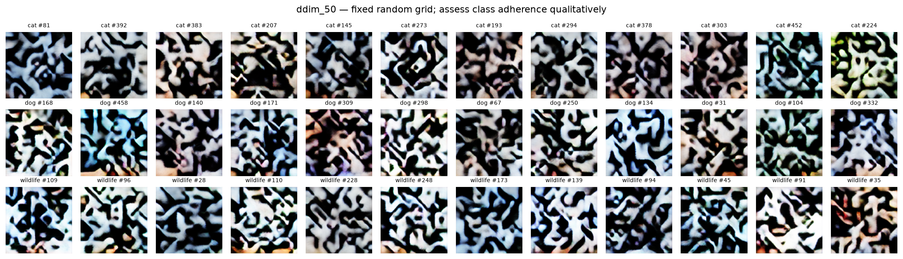
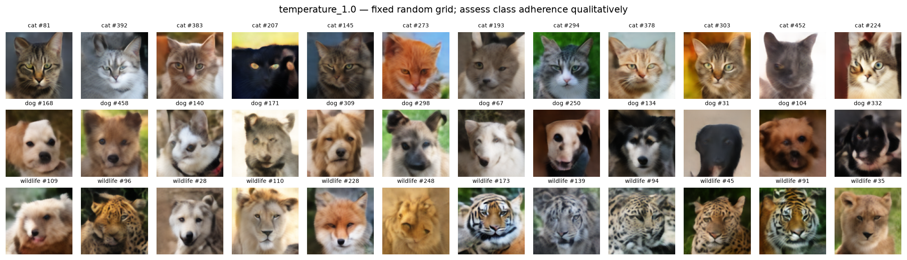
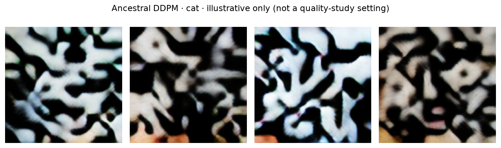
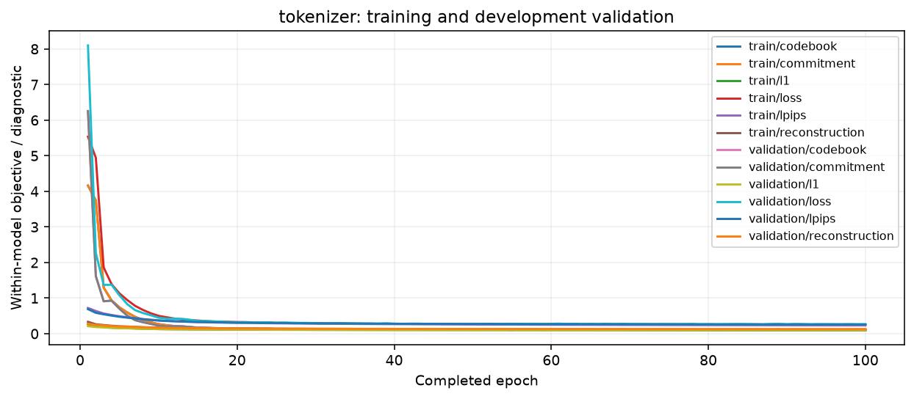
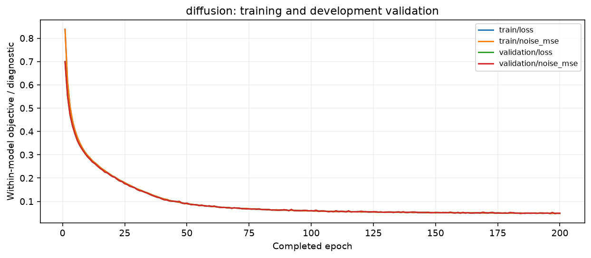
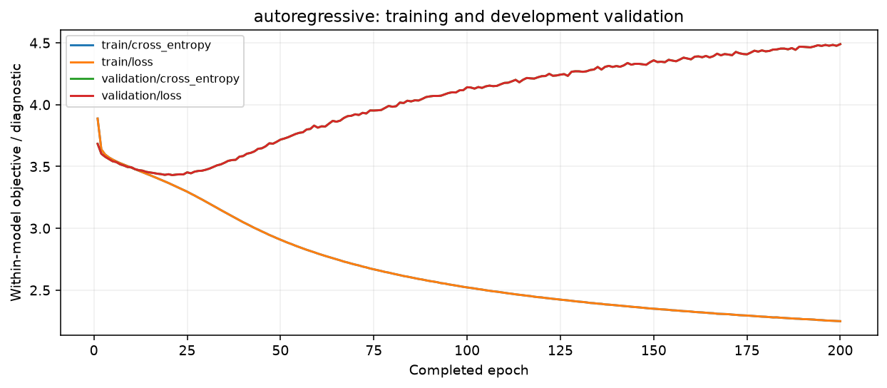

# Animal face generation: a shared-tokenizer comparison

Run `run_001` · evaluation `analysis_001` · executed 1 October 2026.

**The autoregressive Transformer produced recognizable animal faces; the diffusion system produced abstract patterns.** At the predefined primary settings, macro class KID was **0.022591** for the Transformer and **0.336511** for diffusion. DDIM-50 was faster, but its images failed the intended task. This is a negative result for the particular diffusion implementation and training recipe in this run. Its cause remains unresolved; this experiment does not establish a general advantage of autoregression over diffusion.

All three training stages, six evaluation settings and twelve benchmark groups completed. The next useful work is diagnosis with the existing checkpoints, rather than more epochs. This report and its [compact evidence](run_001/summary.json) were assembled from saved artifacts without running training, inference or evaluation again.

## Question and method

With the same dataset, frozen image representation and generator training exposure, how do a denoising U-Net and an autoregressive Transformer compare in quality, diversity and generation speed?

All trainable models were implemented in PyTorch and initialized from scratch. One VQ autoencoder maps a 128×128 RGB image to a 16×16 grid of discrete IDs: 256 positions, a 512-entry codebook and 64 values per code. The Transformer predicts those IDs in raster order. Diffusion predicts Gaussian noise on the corresponding codebook embedding grid. Its inputs use one scalar mean and standard deviation calculated from training embeddings; sampling reverses that normalization, snaps the final output to the nearest codebook entry, and uses the same decoder. Intermediate diffusion states are not quantized or clipped to image bounds.

The design adapts discrete representation learning from [VQ-VAE](https://arxiv.org/abs/1711.00937), denoising from [DDPM](https://arxiv.org/abs/2006.11239), compressed image tokens and Transformer generation from [Taming Transformers](https://arxiv.org/abs/2012.09841), latent-space generation from [Latent Diffusion](https://arxiv.org/abs/2112.10752), and accelerated sampling from [DDIM](https://arxiv.org/abs/2010.02502). The compact architectures, shared quantized representation and exclusion of adversarial tokenizer training are project adaptations. These results are not reproductions of the papers' results.

### Data and isolation

The inventory contains 15,803 images from the authors' [AFHQ v2 release](https://github.com/clovaai/stargan-v2#animal-faces-hq-dataset-afhq). The downloaded archive names its held-out partition `test`; that actual partition, rather than an assumed `val` directory, was preserved for final evaluation. Development validation was carved from upstream training by class with split seed 1001.

| Split | Cat | Dog | Wildlife (`wild`) | Total |
|---|---:|---:|---:|---:|
| Training | 4,559 | 4,211 | 4,134 | 12,904 |
| Development validation | 506 | 467 | 459 | 1,432 |
| Upstream held-out test | 493 | 491 | 483 | 1,467 |
| Balanced evaluation reference | 483 | 483 | 483 | 1,449 |

Preprocessing converts to RGB, resizes to 128×128 with Lanczos and normalizes to `[-1, 1]`; there is no augmentation. Raw-file and pixel identities, split membership and preprocessed-cache identities remain in the preserved run. The compact evidence exports counts and hashes, without redistributing dataset images or membership lists. The observed archive SHA-256 is recorded in [summary.json](run_001/summary.json); it is a locally observed identity, not an independently published checksum.

### Architectures and actual training configuration

| Component | Architecture | Epochs | Microbatch | Effective batch | Optimizer / learning rate |
|---|---|---:|---:|---:|---|
| VQ tokenizer | Residual encoder/decoder, channels 64/128/256, two blocks per stage, three downsampling stages; GroupNorm/SiLU | 100 | 8 per GPU | 64 global | Adam / 0.0002 |
| Diffusion | U-Net at 16→8→4, channels 64/128/256, two blocks per level, four-head attention at 8×8 and 4×4; class and timestep embeddings | 200 | 32 | 64 | AdamW / 0.0001 |
| Transformer | Six pre-norm blocks, width 384, six heads, FFN 1,536, learned positions, dropout 0.1, input-only class prefix | 200 | 32 | 64 | AdamW / 0.0003 |

Training seed was 2027 for each model. Adam-family betas were `(0.9, 0.999)`, epsilon `1e-8`, gradient clipping 1.0 and generator weight decay 0.01. Execution used eager FP32, with mixed precision and TF32 disabled. The tokenizer objective was L1 + 0.1×LPIPS-VGG + codebook loss + 0.25×commitment loss, without a discriminator. Diffusion used noise MSE, 1,000 training timesteps, linear betas 0.0001→0.02 and EMA decay 0.999. The Transformer used next-token cross-entropy and categorical sampling with its KV cache.

**Protocol deviation:** both generators retained `warmup_epochs=0` from the initial test configuration. In the executed scheduler, this makes the learning-rate multiplier 1.0 throughout training. The saved epoch tables confirm constant learning rates for all 200 epochs. The intended full-run schedule was five warm-up epochs followed by cosine decay to 10% of the initial rate. These results must be described as the constant-learning-rate experiment; its effect has not been isolated. The exact [resolved configuration](run_001/run_config.json) accompanies this report.

The shared tokenizer was selected at **epoch 98**, using minimum development-validation L1 + 0.1×LPIPS. Both priors used that checkpoint and the same token cache. Primary evaluation retained the predefined **epoch-200 diffusion EMA** and **epoch-200 Transformer** weights. Best-validation checkpoints were saved but were not substituted after seeing test results. Pretrained VGG-16/LPIPS-v0.1 supplied frozen perceptual supervision; `torch-fidelity`'s frozen `inception-v3-compat` extractor supplied 2,048-dimensional evaluation features. Their exact weight identities are in [summary.json](run_001/summary.json).

## Results and visual evidence

Every evaluated setting generated 483 images per class, for 1,449 images per setting and 8,694 images total. DDIM uses `eta=0`, recorded evenly spaced timestep schedules and shared initial noise across its step variants. Transformer sampling is unrestricted categorical sampling at the stated temperature. Equal numeric seeds across the two families do not imply equivalent random trajectories. See the complete [sampling protocol](run_001/sampling_protocol.json).

| Setting | Macro class KID ↓ | Overall KID ↓ | Overall precision ↑ | Overall recall ↑ | Batch-1 median (s) | Batch-8 images/s |
|---|---:|---:|---:|---:|---:|---:|
| **DDIM 50 — primary** | **0.336511** | **0.300323** | **0.0000** | **0.0000** | **0.2824** | **27.214** |
| DDIM 25 | 0.336399 | 0.299971 | 0.0000 | 0.0000 | 0.1407 | 54.552 |
| DDIM 100 | 0.336498 | 0.300385 | 0.0000 | 0.0000 | 0.5583 | 13.596 |
| **Transformer 1.0 — primary** | **0.022591** | **0.014726** | **0.5328** | **0.4023** | **0.4572** | **16.242** |
| Transformer 0.8 | 0.024303 | 0.016305 | 0.4375 | 0.4099 | 0.4510 | 16.535 |
| Transformer 1.2 | 0.027362 | 0.017851 | 0.4893 | 0.3754 | 0.4541 | 16.213 |

Macro KID is the unweighted mean of cat, dog and wildlife KID. KID uses 100 subsets, with 100 examples per class and 500 overall; estimates are not clipped at zero. Overall subset standard deviations for the primary settings are 0.003273 and 0.001063, respectively. These describe variation over subsets, not confidence intervals, macro-KID uncertainty or variation across training seeds. Precision/recall uses feature-space neighborhoods with `k=3`. Full class results and subset statistics are in [metrics.csv](run_001/metrics.csv).

The primary macro-KID difference is 0.313920, diffusion minus Transformer. The Transformer’s weakest class by KID is dog: 0.040590, versus 0.010342 for cat and 0.016841 for wildlife. Its cat recall is only 0.2050, despite recognizable faces in the grid. No classifier-based conditioning accuracy is claimed. Zero byte-identical generated PNG duplicates in all six sets does not prove diversity or absence of memorization; nearest-training-neighbor measurements remain diagnostics.

The following are the existing fixed sample grids, with twelve samples per class, rather than selected successes. All images shown here are generated outputs; AFHQ reference/reconstruction and nearest-neighbor grids are intentionally excluded from the tracked evidence.

Diffusion failed visually at 25, 50 and 100 DDIM steps. The separate four-image DDPM illustration also failed to produce recognizable cats, so the observed failure is not confined to the DDIM step-count variants. This does not yet identify the cause.

## What the training curves show

**Tokenizer:** the selected checkpoint has development-validation PSNR **23.1206 dB**, LPIPS **0.26205**, reconstruction objective **0.12817**, perplexity **57.53**, and **62/512 used codes (12.11%)**. Local reconstruction inspection preserved recognizable faces with lost detail. Low codebook usage is a representation limitation worth investigating. Reconstruction metrics are not mathematical bounds on generation metrics, and this limitation alone does not explain why the Transformer generates faces while diffusion does not.

**Diffusion:** final training noise MSE is **0.04839** and raw-model validation MSE is **0.04949**; the best raw-model validation MSE is **0.04774 at epoch 198**. Those curves do not establish successful generation. They also measure raw weights, whereas the primary samples use EMA weights. A static source review found no obvious sampler or normalization error; numerical diagnosis is still required before calling this an implementation bug or a limitation of the training objective.

**Transformer:** development-validation cross-entropy is best at **epoch 21: 3.43061**, then worsens to **4.48964 at epoch 200** while training loss falls to **2.24908**. This is clear evidence of overfitting under this recipe. The agreed final-epoch comparison remains intact; a later best-validation checkpoint analysis must be labelled secondary rather than replacing it. The losses of the three families are different objectives and should not be compared numerically with one another.

## Execution and measured cost

Execution used **two NVIDIA L40S GPUs**, Linux x86-64, Python **3.12.3**, PyTorch **2.14.0+cu130**, torchvision **0.29.0**, CUDA build **13.0** and driver **595.91.07**. Tokenizer training used two DDP ranks; afterward diffusion and Transformer trained concurrently, one GPU each. Evaluation and benchmarks ran serially on one GPU. There were four CPU threads per worker, eight preparation I/O threads and zero DataLoader workers. The notebook set `NCCL_DEBUG=INFO` and `NCCL_P2P_DISABLE=1` following a startup communication problem on this Pod; this is an execution detail, not a universal NCCL recommendation.

| Stage | Parameters | Training image exposures | Sum of train + validation epoch time | Worker elapsed time |
|---|---:|---:|---:|---:|
| Shared tokenizer | 7,467,843 | 1,290,400 | 43 min 48 s | 44 min 52 s |
| Diffusion | 10,940,288 | 2,580,800 | 43 min 05 s | 46 min 04 s |
| Transformer | 11,140,224 | 2,580,800 | 41 min 50 s | 44 min 11 s |

Epoch timings include development validation but exclude checkpoint serialization. Worker timings include startup and checkpoint overhead. The two generator durations overlap and must not be added as sequential wall time. Equal exposure is not equal parameter count, compute or convergence. Best/final/resume checkpoint files are approximately 85.62 MiB each for the tokenizer, 167.20 MiB for diffusion and 127.59 MiB for the Transformer; these are full training-state files, including optimizer state and EMA where applicable, not weight-only exports.

The recorded session spans approximately **1 h 43 min 19 s**, from **14:28:31 to 16:11:50 IST on 1 October 2026** (08:58:31–10:41:50 UTC), from hardware inspection to the report worker’s completion. This includes notebook gaps but excludes earlier installation, original asset downloads and troubleshooting. The download and weight-acquisition jobs reused caches; this is not a clean-machine end-to-end setup time. No billed cost is claimed because no billing record was provided. All 35 worker receipts completed with exit code zero; the downloaded notebook contains 86 executed code cells and no saved error outputs. See [jobs.csv](run_001/jobs.csv).

### Benchmark boundaries

Each of six settings was measured at batch sizes 1 and 8 with three warm-ups and 30 timed repetitions, with accelerator synchronization. Timing includes random sampling, transfers, the prior, final code lookup/snapping, shared decoding and conversion to CPU uint8 outputs. Model loading, disk writes, plotting, feature extraction and metric computation are excluded. Throughput is total images divided by total measured time, rather than the reciprocal of the median.

For the primary batch-1 measurements, DDIM-50 median/p95 latency was **0.2824/0.3064 s**, versus **0.4572/0.4778 s** for the Transformer. Their first-call measurements were **0.8808 s** and **0.9427 s**. These use a newly constructed wrapper inside an existing worker process; they are not fresh-process, cold-OS or cold-device measurements. The saved [benchmark summaries](run_001/benchmarks.csv) and [360 raw trials](run_001/benchmark_trials.csv) preserve all settings.

Sampled process RSS and CUDA allocation/reservation counters are observations, not whole-Pod memory requirements. CUDA allocator peak counters are separately named in the export. Telemetry polling can miss short spikes; child-process RSS can count shared pages more than once. Host-global CPU and available-RAM values do not describe the Pod allocation and are omitted from this compact export. Measurements include monitoring overhead and uncontrolled host conditions. Diffusion’s lower latency is not a useful quality/speed win while its samples fail visually.

## Validity, recovery and next experiment

One seed, one dataset, one shared learned tokenizer and small held-out reference sets limit inference. The two systems differ in architecture and loss, and the actual constant-LR schedule deviates from the intended full-run schedule. The observations cannot establish a universal winner, convergence, semantic conditioning accuracy, or freedom from memorization.

A read-only audit before this documentation update checked split isolation, shared codec/cache identity, selected-checkpoint hashes and all 8,694 generated evaluation PNG hashes. Recalculation from saved features agreed with all 24 overall/per-class metric groups; all twelve timing summaries agreed with their raw trials. Those checks support internal consistency, not the correctness of every model operation or causal attribution of the diffusion failure. This documentation export did not rerun those experiments.

An earlier implementation handoff recorded 178 passing offline synthetic tests. That remains historical validation. During submission preparation on 9 November 2026, an output-free public notebook was derived from the preserved executed notebook and its contract checks were aligned with the actual 100/200/200 configuration. This publication-only preparation does not constitute a new full-suite, training or GPU correctness result; the original run and its source snapshot remain unchanged.

The downloaded source snapshot is missing `.python-version`, although the recorded manifest requires it; normal run verification therefore needs that exact historical file recovered. Normal saved-model loading also enforces the original environment/backend/topology, so direct cloud-to-Mac loading through that helper is not currently portable. This report preserves those limitations and does not modify the snapshot, checks or checkpoints. The original working notebook’s introductory one-epoch wording is stale; the public copy corrects that prose while preserving the recorded training configuration.

The next experiment should use **development validation only**:

1. Compare raw and EMA diffusion weights with fixed validation latents, timestep-binned noise errors and fixed sampling seeds.
2. Inspect training versus sampled latent statistics, quantization distances and generated code-ID usage. Determine whether samples snap to codes rarely or never used by the tokenizer; this is a hypothesis, not an established failure cause.
3. Check denoising and decoding end to end using known validation examples. Revisit the schedule, representation or implementation only after these checks identify an actionable issue.
4. Treat the Transformer’s best-validation checkpoint as a separate diagnostic; do not spend more epochs on the current overfitting trajectory without changing and validating the recipe.

The original test results have already been inspected. Any changes motivated by these results are follow-up development; comparisons on the same test set must be labelled exploratory, not an untouched confirmatory evaluation. No additional training is justified solely by the fact that diffusion’s pictures are poor.

## Evidence and attribution

[summary.json](run_001/summary.json) contains exact measurements and selected identities; [training CSVs](run_001/training/) retain each epoch; [evidence_manifest.json](run_001/evidence_manifest.json) records source and exported SHA-256 hashes with transformation descriptions. Its source paths are relative to the project root. This compact evidence is about 4.4 MB and is intended to remain tracked when `runs/`, `jobs/`, model weights and caches are ignored. It does not replace the full local backup: independent metric extraction and checkpoint reconstruction need the preserved features, weights and data. Hashes establish correspondence to saved files, not independent authenticity of the experiment.

The original automatic report remains unchanged at the project-relative path `runs/run_001/evaluation/analysis_001/report.md` and is available only with local run artifacts; it is excluded from the GitHub submission. This authored report adds interpretation and protocol deviations. Existing generated grids and curves were copied without alteration; no AFHQ originals, reconstructions or nearest-neighbor image panels are redistributed here.

AFHQ v2 is supplied by the StarGAN v2 authors under its **CC BY-NC 4.0 noncommercial terms**. Dataset and pretrained-weight rights are not granted by this report; retain the [project notices](../NOTICE.md) and upstream attribution. Metric references are [KID](https://arxiv.org/abs/1801.01401) and [improved precision/recall](https://arxiv.org/abs/1904.06991); pretrained implementations are [LPIPS](https://github.com/richzhang/PerceptualSimilarity) and [torch-fidelity](https://github.com/toshas/torch-fidelity).
